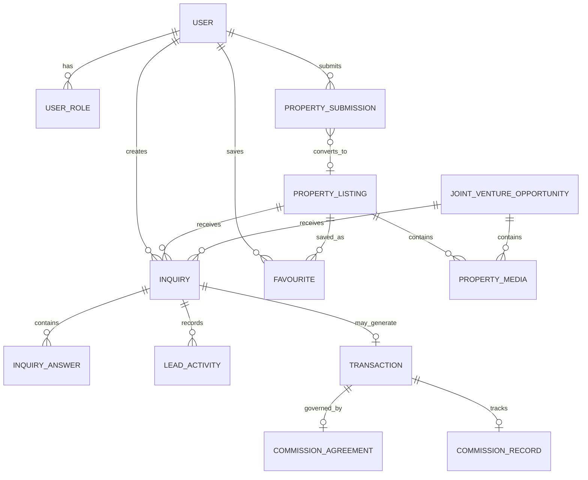

# Conceptual Data Model

This is a logical starting point, not a final Prisma schema. Confirm fields and constraints during implementation.

## 1. Identity and roles

### User
- `id`
- `email` (unique, normalized)
- `emailVerifiedAt`
- `phone`
- `name`
- `activeRole` (nullable preference only)
- `status` (`ACTIVE`, `SUSPENDED`, `DELETED`)
- `createdAt`, `updatedAt`

### UserRole
- `id`
- `userId`
- `role` (`BUYER`, `TENANT`, `INVESTOR`, `OWNER`, `BROKER`, `BUILDER`)
- `createdAt`
- unique `(userId, role)`

### StaffMembership
- `id`
- `userId`
- `staffRole` (`SUPER_ADMIN`, `LISTING_MANAGER`, `LEAD_MANAGER`, `CONTENT_MANAGER`, `ANALYST`)
- `active`
- `createdAt`

For fine-grained permissions, add `StaffPermission` or role-to-permission mapping.

### ConsentRecord
- `id`
- `userId` (nullable for pre-account events if needed)
- `purpose`
- `policyVersion`
- `consentedAt`
- `withdrawnAt`
- `source`
- Do not treat acceptance of contact consent as marketing consent.

## 2. Property catalogue

### PropertyListing
- `id`, `slug`
- `title`
- `description`
- `category` (`RESIDENTIAL`, `COMMERCIAL`, `MIXED_USE`, `INDUSTRIAL`, `LAND`)
- `subtype`
- `transactionType` (`SALE`, `RENT`, `LEASE`, `OTHER`)
- `status` (`DRAFT`, `IN_REVIEW`, `PUBLISHED`, `PAUSED`, `SOLD`, `RENTED`, `ARCHIVED`)
- `visibility` (`PUBLIC`, `BUILDER_ONLY`, `PRIVATE`)
- `state`, `city`, `locality`, `pincode` (nullable as appropriate)
- `latitude`, `longitude` (private by default; publish only approved generalized coordinates)
- `builtUpArea`, `carpetArea`, `plotArea`, `areaUnit`
- category-specific attributes (prefer typed columns or related attribute model for important searchable fields)
- `bedrooms`, `bathrooms`, `balconies`, `floorNumber`, `totalFloors`
- `furnishing`, `facing`, `parkingCount`, `ageOfProperty`
- `amenities` relation
- `privateSalePrice`, `privateRentAmount`, `privateDeposit`, `priceNegotiable` (never public)
- `publicContactMode` (normally inquiry)
- `createdByStaffId`, `updatedByStaffId`
- `publishedAt`, `createdAt`, `updatedAt`, `archivedAt`

### PropertyMedia
- `id`
- `propertyId` or `jvOpportunityId` (exactly one parent)
- `storageKey`
- `mediaType`
- `altText`
- `sortOrder`
- `isCover`
- `visibility`
- `createdAt`

### Amenity
- `id`, `name`, `slug`, `category`
### PropertyAmenity
- `propertyId`, `amenityId`

### Location
Possible normalized reference tables:
- `State`
- `City`
- `Locality`
Use provider IDs only as optional external mapping fields; do not make provider availability a hard dependency.

## 3. User-submitted property intake

### PropertySubmission
- `id`
- `submittedByUserId`
- `submitterRole`
- `relationshipToProperty` (`OWNER`, `AUTHORIZED_REPRESENTATIVE`, `BROKER`, `BUILDER`, `OTHER`)
- `category`, `subtype`, `transactionType`
- `title`, `description`
- location and area fields
- contact preference
- `status` (`RECEIVED`, `UNDER_REVIEW`, `NEEDS_INFORMATION`, `ACCEPTED`, `DECLINED`, `CONVERTED`)
- `assignedStaffId`
- `reviewNotes` (staff-only)
- `convertedPropertyId` (nullable)
- timestamps

A submission is not a public listing. Conversion must be an explicit admin action that creates a `PropertyListing`.

## 4. Inquiry / CRM

### Inquiry
- `id`
- `publicReference` (unguessable or non-sequential)
- `userId`
- `propertyId` (nullable for general inquiry)
- `jvOpportunityId` (nullable)
- `intent` (`BUY`, `RENT`, `INVEST`, `SELLER_SUBMISSION`, `BROKER`, `BUILDER`, `JV`)
- `status`
- `contactName`, `contactEmail`, `contactPhone`
- `message`
- `consentRecordId`
- `sourcePage`, `utm fields` (with privacy controls)
- `assignedStaffId`
- `createdAt`, `updatedAt`

### InquiryAnswer
- `id`
- `inquiryId`
- `questionKey`
- `answer` (JSON or typed value)
- Avoid storing unnecessary sensitive information.

### LeadActivity
- `id`
- `inquiryId`
- `actorUserId`
- `activityType`
- `fromStatus`, `toStatus`
- `note` (staff-only unless explicitly marked user-visible)
- `createdAt`

## 5. JV

### JointVentureOpportunity
- `id`, `slug`
- `title`, `description`
- `location`
- `landArea`, `areaUnit`
- `collaborationType`
- `requirements`
- `status` (`DRAFT`, `PUBLISHED`, `PAUSED`, `CLOSED`)
- `visibility` (must be builder-only for MVP)
- private commercial/owner details
- timestamps and staff audit fields

Enforce builder authorization for the JV record, media, search, and inquiry endpoints.

## 6. User engagement

### Favourite
- `userId`, `propertyId`, `createdAt`
- unique `(userId, propertyId)`

### Comparison
Could be client-side initially. If persisted:
- `id`, `userId`, `createdAt`
- `ComparisonItem` with ordered property IDs.
- Enforce ownership.

## 7. Transaction and commission tracking

### Transaction
- `id`
- `propertyId`
- `originatingInquiryId`
- `status` (`POTENTIAL`, `IN_PROGRESS`, `SUCCESSFUL`, `CANCELLED`, `DISPUTED`)
- `completionEvidenceReference` (private)
- `completionDate`
- `createdAt`, `updatedAt`

### CommissionAgreement
- `id`
- `transactionId`
- `payerParty`
- `basisType` (`PERCENTAGE`, `FIXED`, `NEGOTIATED`)
- `rateOrAmount`
- `currency` (INR default)
- `termsVersion`
- `acceptedAt`
- `status`

### CommissionRecord
- `id`
- `transactionId`
- `amountDue`
- `amountReceived`
- `dueDate`
- `status`
- `paymentReference`
- private finance notes

Do not activate payment collection until legal and commercial terms are approved.

## 8. Audit

### AuditLog
- `id`
- `actorUserId`
- `action`
- `entityType`
- `entityId`
- `before` / `after` safe JSON snapshots
- `requestId`
- `createdAt`

Never store OTP values, passwords, full identity documents, or unnecessary personal data in audit snapshots.

## 9. Relationship overview

