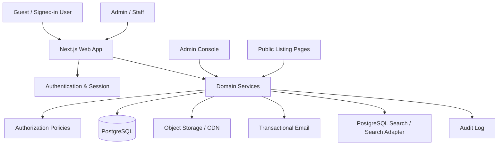

# Technical Requirements & Design (TRD)

## 1. Technical direction

Recommended stack, aligned with the product owner's preference for a modern TypeScript stack:

| Layer | Recommendation |
|---|---|
| Web application | Next.js App Router + TypeScript |
| UI styling | Tailwind CSS |
| Components | Accessible component primitives (e.g. shadcn/ui where appropriate) |
| Backend | Next.js server actions/route handlers initially; isolate domain services |
| Database | PostgreSQL |
| ORM | Prisma |
| Validation | Zod |
| Authentication | Auth.js-compatible email OTP flow or a reputable transactional auth provider |
| Email | Transactional email provider with OTP templates |
| File storage | S3-compatible object storage or Cloudinary |
| Image delivery | CDN + responsive transformations |
| Hosting | Vercel or equivalent; managed PostgreSQL |
| Observability | Structured logs, error monitoring, uptime checks |
| Testing | Vitest/Jest, React Testing Library, Playwright |
| CI/CD | GitHub Actions |

Do not select a paid vendor or create accounts without product-owner approval. Keep provider integrations behind interfaces so they can be changed.

## 2. Architectural principles

- Modular monolith for MVP; avoid premature microservices.
- Server-first rendering for public SEO pages.
- Domain services own business rules; UI components must not implement authorization.
- Zod validation at every trust boundary.
- Database constraints and indexes enforce critical invariants where possible.
- Role checks and JV authorization occur on the server for every request.
- Separate public DTOs from internal database models so private prices and staff-only data cannot leak.
- Admin-only listing writes.
- Audit all sensitive admin operations.
- Use object storage for media; database stores metadata and object keys.
- Do not store OTP plaintext; store a hash or delegate securely to provider.
- Do not log OTPs, passwords, full sensitive form bodies, or private pricing.

## 3. High-level architecture



## 4. Application modules

1. Identity & authentication
2. User profiles and roles
3. Public property discovery
4. Property taxonomy and attributes
5. Admin listing management
6. Property submission intake
7. Inquiry and lead management
8. Builder-only JV opportunities
9. Media management
10. Content/SEO
11. Notifications
12. Commission/transaction tracking (initially tracking-ready; collection later)
13. Audit and reporting

## 5. Suggested project structure

```text
src/
  app/
    (public)/
      page.tsx
      properties/
      joint-ventures/
    (auth)/
      sign-in/
      verify-email/
    (account)/
      account/
      inquiries/
      saved/
      compare/
      submissions/
    admin/
      dashboard/
      listings/
      submissions/
      inquiries/
      users/
      joint-ventures/
      settings/
    api/
  components/
    layout/
    property/
    search/
    inquiry/
    forms/
    admin/
    ui/
  features/
    auth/
    users/
    properties/
    submissions/
    inquiries/
    joint-ventures/
    media/
    commissions/
  lib/
    auth/
    db/
    env/
    email/
    storage/
    validation/
    rate-limit/
    logging/
  server/
    policies/
    services/
    repositories/
    dto/
  prisma/
    schema.prisma
    migrations/
  tests/
```

Agents may adjust structure if they document why and preserve module boundaries.

## 6. Authorization model

### 6.1 Principals

- `ANONYMOUS`: public browsing only.
- `USER`: authenticated account.
- User roles: `BUYER`, `TENANT`, `INVESTOR`, `OWNER`, `BROKER`, `BUILDER`.
- Staff roles: `SUPER_ADMIN`, `LISTING_MANAGER`, `LEAD_MANAGER`, `CONTENT_MANAGER`, `ANALYST`.

### 6.2 Policy matrix

| Action | Guest | Buyer/Tenant/Investor | Owner/Broker | Builder | Authorized admin |
|---|---:|---:|---:|---:|---:|
| Browse public listings | Yes | Yes | Yes | Yes | Yes |
| View public property detail | Yes | Yes | Yes | Yes | Yes |
| See public price | No | No | No | No | Private admin only |
| Send property inquiry | Start onboarding | Yes | Yes | Yes | Yes |
| Save/compare | No (local compare optional) | Yes | Yes | Yes | Yes |
| Submit property to admin | No | Optional | Yes | Yes | Yes |
| Publish/edit public listing | No | No | No | No | Permission-gated |
| View JV opportunities | No | No | No | Yes | Permission-gated |
| Manage JV records | No | No | No | No | Permission-gated |
| View another user's inquiry | No | No | No | No | Assigned/permission-gated |
| View own inquiry | No | Yes | Yes | Yes | Yes |
| Manage users/roles | No | No | No | No | Permission-gated |

A user's active role is a presentation preference. It is not an authorization grant. The actual `UserRole` rows are authoritative.

### 6.3 Staff permission model

Prefer explicit permissions, e.g.:
- `listing.read`, `listing.create`, `listing.update`, `listing.publish`, `listing.archive`
- `submission.read`, `submission.review`, `submission.convert`
- `lead.read`, `lead.assign`, `lead.update`, `lead.export`
- `user.read`, `user.update`, `user.suspend`, `user.assign_role`
- `jv.read`, `jv.create`, `jv.update`, `jv.publish`
- `analytics.read`, `settings.manage`

Super Admin receives all permissions. Other staff roles receive least-privilege sets.

## 7. Data and privacy boundaries

### 7.1 Public property DTO

Public listing responses must use an explicit allowlist:
- id / slug
- title
- public category and subtype
- transaction intent (sale/rent/lease)
- public description
- location fields at approved granularity
- area and category-appropriate attributes
- amenities
- public media
- public status/availability label
- published/updated timestamps
- CTA configuration

Never serialize:
- sale price, rent, deposit, expected price, negotiability
- owner's private phone/email
- private owner identity documents
- internal notes
- lead/inquiry data
- admin review notes
- private exact address/coordinates if not approved for public display

Do not rely on CSS to hide private fields. Do not select private price columns in public queries.

### 7.2 JV data

- JV records have `visibility = BUILDER_ONLY` and a server policy.
- Exclude from public listing search, public sitemap, public feeds, public caches and public recommendations.
- Do not return restricted records and rely on frontend hiding.
- Prevent IDOR by checking authorization on detail, inquiry, media, and related-resource endpoints.
- Use `Cache-Control: private, no-store` for authenticated JV responses unless a carefully designed role-aware cache exists.

## 8. Domain model

See `DATA_MODEL.md` for the conceptual schema. Core entities:
- User
- UserProfile
- UserRole
- StaffMembership / StaffPermission
- PropertyListing
- PropertyMedia
- PropertySubmission
- Inquiry
- InquiryAnswer
- LeadAssignment
- LeadActivity
- JointVentureOpportunity
- Favourite
- PropertyComparison (optional; may be client-side first)
- Transaction
- CommissionAgreement
- CommissionRecord
- ConsentRecord
- AuditLog
- Location (or normalized location fields)

## 9. Search and filtering

MVP can use PostgreSQL:
- indexed location fields
- category, subtype, transaction type, status
- area numeric ranges
- bedroom/bathroom counts where applicable
- amenities via join table or JSONB (choose based on query needs)
- `tsvector`/full-text search for title, description and location
- cursor or stable offset pagination; enforce maximum page size

Do not implement public price filtering because public prices are not displayed. Private admin filters may include price.

For India-wide locations, use normalized state/city/locality data. Avoid a single free-text location field as the only source of truth. Keep provider/geocoding integration replaceable.

## 10. API conventions

- JSON over HTTPS.
- Version API routes when public/external consumers are introduced.
- Use consistent error shape: `{ "error": { "code": "...", "message": "...", "fieldErrors": {} } }`.
- Validate all input with Zod.
- Use authenticated session from server, never trust `userId`, `role`, or `isAdmin` from request body.
- Rate-limit OTP send/verify, inquiry creation, search abuse and admin login.
- Use idempotency key for inquiry creation where appropriate.
- Paginate lists and set maximum page size.
- Return explicit DTOs; never return Prisma models directly.

See `API_CONTRACT.md`.

## 11. Authentication design

Preferred MVP:
1. User submits email.
2. Server requests OTP from provider or generates a cryptographically secure code.
3. Apply per-email, per-IP and global rate limits.
4. Store only a hash of OTP, expiry, attempt count and purpose; never log code.
5. Verify OTP, enforce expiry and attempt limits.
6. Create or resume account and secure session.
7. Collect phone number at inquiry time (or onboarding if needed) and store as unverified contact data.
8. Record consent and timestamp.

Recommended controls:
- Short OTP lifetime (e.g. 5–10 minutes; finalize with provider).
- Maximum verification attempts.
- Resend cooldown.
- Generic response to avoid account enumeration.
- Secure, HttpOnly, SameSite cookies.
- Session rotation after authentication.
- CSRF protection where applicable.
- Logout/revoke session.

## 12. Media handling

- Accept only allowlisted image formats; validate actual file signature, not extension alone.
- Enforce upload size and image dimension limits.
- Strip EXIF metadata, especially GPS, before public delivery.
- Generate responsive variants and thumbnails.
- Randomize object keys; never trust original filename as storage path.
- Malware scan where supported.
- Admin-only upload and listing-media association in MVP.
- Use signed upload URLs or server-mediated uploads with short expiry.
- JV media must follow the same builder-only authorization as the JV record.

## 13. Security requirements

- OWASP Top 10 baseline.
- Server-side RBAC/permission checks on every protected action.
- No secrets in client bundles or repository.
- Environment variables validated at startup.
- Parameterized ORM queries; avoid unsafe raw SQL.
- Content sanitization for rich text.
- Rate limits and bot protection for OTP and inquiry endpoints.
- Strict security headers and CSP.
- Secure cookies and TLS.
- Audit log for listing publication, private price changes, role changes, JV changes, lead access/export, commission updates.
- Least-privilege staff permissions.
- Backups encrypted and restore-tested.
- Data export/deletion workflow aligned with applicable Indian privacy law and legal advice.
- No Aadhaar/PAN collection in MVP.
- Avoid collecting exact home address unless operationally necessary.

## 14. Performance, SEO and accessibility

- Use server rendering for indexable public listing pages.
- Optimize image delivery and lazy-load below-the-fold media.
- Use pagination, database indexes and query profiling.
- Cache only public, price-free, non-JV content.
- Never cache authenticated or builder-only content in a shared public cache.
- Canonical URLs and structured metadata must omit price.
- Noindex account, admin, inquiry, and JV pages.
- Semantic HTML, keyboard navigation, visible focus, labels, contrast and accessible validation.

## 15. Observability and operations

Log:
- request ID, route, status, latency, safe actor identifier, error code
- inquiry created, assigned, contacted, status changed
- listing submitted, approved, published, unpublished
- OTP requested/verified/failed (never OTP value)
- JV authorization denied (without leaking record details)

Monitor:
- application errors and latency
- database health and slow queries
- email delivery and OTP failure rate
- inquiry volume and response time
- listing publication throughput
- storage failures
- backup completion

## 16. Environments and release

- Local development
- Staging with synthetic data
- Production with restricted access

Required before production:
- domain and HTTPS
- production email sender/domain authentication
- managed database and backups
- object storage/CDN
- environment/secret management
- monitoring and alerting
- privacy policy, terms, cookie policy if applicable
- admin access and incident response procedure
- database migration/rollback plan
- tested restore procedure

## 17. Technical decisions to confirm

See `DECISIONS_AND_OPEN_QUESTIONS.md`, especially auth provider, hosting, map/geocoding provider, search provider, operating hours, and commission lifecycle.
