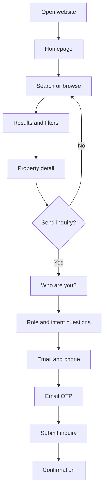

# UX Flows and Screen Inventory

## Design direction

- Mobile-first, premium, modern.
- Clean typography, generous spacing, strong photography, restrained color palette.
- Prioritize property imagery and location/context.
- Avoid cluttered portal-style density on mobile.
- Use clear, direct CTAs and visible filter controls.
- Desktop may use richer multi-column layouts while preserving mobile information hierarchy.
- Accessibility and fast loading take priority over decorative animation.

## Global navigation

Public:
- Home
- Buy
- Rent
- Commercial
- Land
- Residential-cum-commercial
- Industrial
- Joint Ventures (only shown to builder-role signed-in users)
- About / How it works
- Contact

Account:
- Profile
- My roles / Switch role
- My inquiries
- Saved properties
- Compare
- Property submissions (owner/broker/builder)
- Sign out

Admin:
- Dashboard
- Listings
- Property submissions
- Inquiries / Leads
- JV opportunities
- Users and roles
- Media
- Reports
- Settings
- Audit log

## Screen inventory

### Public screens
1. Homepage
2. Search results
3. Property detail
4. Category landing pages
5. Location landing pages
6. About/how it works
7. Contact
8. Sign-in/email OTP
9. Inquiry form
10. Inquiry confirmation

### User screens
1. Account profile
2. Role selection/add roles
3. Role switcher
4. My inquiries
5. Saved properties
6. Compare properties
7. Submit property to admin
8. My property submissions
9. Builder JV opportunity list/detail/inquiry

### Admin screens
1. Admin dashboard
2. Listing list/create/edit/preview
3. Listing media manager
4. Property submission queue/detail/review
5. Inquiry inbox/detail/assignment/activity
6. User list/detail/role management
7. JV list/create/edit/visibility
8. Analytics/reporting
9. Audit log
10. Settings and staff permissions

## Flow 1: Guest discovery

## Flow 2: Role onboarding

Prompt: **“Who are you?”**

Allow multiple selections:
- Looking to buy
- Looking to rent
- Investor
- Property owner / seller
- Broker / property dealer
- Builder / developer

Then ask the next question based on selected roles. Do not ask all possible questions in one long form.

- Buyer: “What kind of property are you looking for?”
- Tenant: “What type of property do you need to rent?”
- Investor: “What kind of opportunity are you exploring?”
- Owner: “Do you want to submit a property for our team to review?”
- Broker: “Are you looking for properties for clients or submitting a property mandate?”
- Builder: “Are you exploring projects, land, or joint-venture opportunities?”

Collect contact details only when the user proceeds to an inquiry or submission.

## Flow 3: Inquiry

- Contextual property title and thumbnail shown.
- Ask only relevant requirements.
- Contact name, email, phone.
- Email OTP.
- Consent text: explain that platform representatives may contact the user about this inquiry.
- Submit.
- Confirmation with inquiry reference.
- Do not show private price in confirmation or URL.

## Flow 4: Submit property to admin

- User chooses “Submit a property”.
- Capture property category and location.
- Capture area and core property facts.
- Capture user's relationship to the property (owner, authorized representative, broker, builder).
- Optional supporting information/documents only if needed and with secure handling.
- Create submission with `RECEIVED` status.
- Explain: “Our listing team will review your details. Submission does not mean the property is published.”
- Admin reviews and may request more information or create a listing.

## Flow 5: Builder JV

- Builder signs in and has `BUILDER` role.
- JV navigation appears.
- Server checks builder role.
- Builder browses opportunities and submits inquiry.
- Non-builder direct URL/API attempt returns a generic 403/404 response without record details.

## Key UI states

Every data-driven screen must include:
- Loading
- Empty
- Error/retry
- Success
- Unauthorized / session expired
- Offline or network failure where relevant

## Copy guidance

Preferred:
- “Send Inquiry”
- “Call to Get Price”
- “Request Property Details”
- “Submit Property for Review”
- “Explore Joint Ventures” (builder-only)

Avoid:
- “Verified property” unless the specific verification is defined and evidenced.
- “Guaranteed returns”.
- “Best price guaranteed”.
- “Get price in 2 minutes” until an operational SLA is approved and monitored.

Suggested safe interim copy:
**“Send an inquiry to get the latest price and property details.”**
